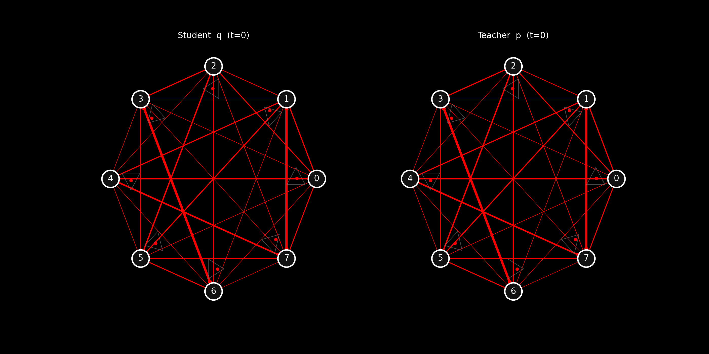
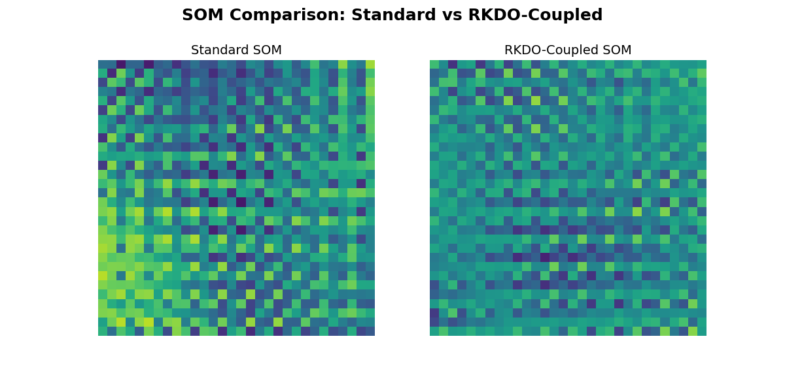

# RKDO - Recursive KL Divergence Optimization

This repository contains the official implementation of Recursive KL Divergence Optimization (RKDO), a dynamic framework for representation learning that generalizes neighborhood-based KL minimization methods.

## Overview

RKDO reframes representation learning as a recursive divergence alignment process over localized conditional distributions. While existing frameworks like Information Contrastive Learning (I-Con) unify multiple learning paradigms through KL divergence between fixed neighborhood conditionals, RKDO captures the temporal dynamics of representation learning by applying recursive updates to the entire response field.

[](./visualizations/data/rkdo_kaleidoscope_split_8.gif)

*Click the visualization above to see the split student/teacher view in max resolution*

### The Kaleidoscopic RKDO Visualization

This visualization blends insights from RKDO theory with Amari's information geometry framework, revealing the dynamic evolution of probability distributions during training:

- **Star Graph Structure**: Nodes arranged in probability space with edge colors indicating KL-divergence values and edge weights showing relationship strengths
- **Triangular 'Petal' Simplices**: Each node features a simplex visualizing probability distributions, with blue dots (q) representing the student's learned distributions and red dots (p) showing the teacher's target distributions
- **Gradient Dynamics**: Purple and green arrows illustrate Euclidean and natural gradients respectively, highlighting different paths in the probability manifold
- **Split-Screen View**: The linked full visualization contrasts the more exploratory nature of the student distributions (left) against the more stable, structured teacher distributions (right)

The visualization captures how RKDO's recursive coupling between student and teacher distributions leads to their progressive alignment over time.

### RKDO-Coupled Self-Organizing Maps



**Figure: Comparison of Standard vs RKDO-Coupled Self-Organizing Map Evolution**

This side-by-side animation compares two Self-Organizing Map (SOM) approaches learning from the same evolving spatiotemporal data over 200 time steps. Each frame shows a 10×10 grid of learned prototypes, where each cell displays a 3×3 pattern representing the SOM's internal representation of local spatial features. Colors indicate different state values in the underlying dynamic system.

**Left (Standard SOM):** Uses traditional exponential decay schedules for learning rate and neighborhood radius, following a predetermined adaptation timeline regardless of input distribution changes.

**Right (RKDO-Coupled SOM):** Employs Recursive Kullback-Leibler Divergence Optimization, where the learning rate adapts dynamically based on the KL divergence between the SOM's prior activation distribution and current input-driven activations. This creates a feedback loop where learning intensity responds to the novelty of input patterns.

The visual differences reveal how adaptive learning schedules (RKDO) can produce different prototype organization compared to fixed exponential decay, particularly when the underlying data distribution shifts over time. The RKDO approach demonstrates more responsive adaptation to changes in the evolving spatial patterns, while the standard approach follows a rigid learning schedule independent of input characteristics.

*The notebook for this visualization is found in `./som_rkdo/som_rkdo.ipynb`*

## Key Findings

Our experiments demonstrate that RKDO offers dual efficiency advantages:

1. **Optimization Efficiency**: RKDO consistently achieves approximately 30% lower loss values compared to static approaches across CIFAR-10, CIFAR-100, and STL-10 datasets.

2. **Computational Resource Efficiency**: RKDO requires 60-80% fewer computational resources (training epochs) to achieve results comparable to longer I-Con training.

## Repository Structure

- `RKDO_benchmark.ipynb` and `RKDO_benchmark_latest.ipynb`: Notebooks containing the experiments from the paper
- `visualizations/kaleidoscope.py`: Script for generating the kaleidoscopic visualizations
- `visualizations/data`: Directory containing output visualizations and experimental visualizations
- `som_rkdo/som_rkdo.ipynb`: Notebook demonstrating RKDO application to Self-Organizing Maps

## Installation

```bash
# Clone the repository
git clone https://github.com/anthonymartin/RKDO-recursive-kl-divergence-optimization rkdo
cd rkdo

# Install dependencies
pip install -r requirements.txt
```

## Usage

To reproduce the main experiments from the paper:

```python
# Run the benchmark notebook
jupyter notebook RKDO_benchmark_latest.ipynb
```

To generate the visualizations:

```bash
cd visualizations
python kaleidoscope.py
```

To explore RKDO-coupled Self-Organizing Maps:

```python
# Run the SOM notebook
jupyter notebook som_rkdo/som_rkdo.ipynb
```

## Method

RKDO formalizes representation learning as:

$$L^{(t)} = \frac{1}{n}\sum_{i=1}^{n}D_{KL}(p^{(t)}(\cdot|i)\|q^{(t)}(\cdot|i))$$

where $p^{(t)}(\cdot|i)$ is the supervisory distribution and $q^{(t)}(\cdot|i)$ is the learned neighborhood distribution, both recursively defined:

$$p^{(t)} = (1 - \alpha) \cdot p^{(t-1)} + \alpha \cdot q^{(t-1)}$$

This recursive formulation empirically creates a more efficient optimization trajectory, particularly in early training stages.

## Citation

If you find this work useful for your research, please cite our paper:

```bibtex
@article{martin2025recursive,
  title={Recursive KL Divergence Optimization: A Dynamic Framework for Representation Learning},
  author={Martin, Anthony D.},
  journal={arXiv preprint arXiv:2504.12345},
  year={2025}
}
```

## License

This project is licensed under the AGPL License - see the LICENSE file for details.

## Acknowledgments

We thank the authors of the Information Contrastive Learning (I-Con) framework for providing a unified perspective on representation learning that helped inspire this work.
